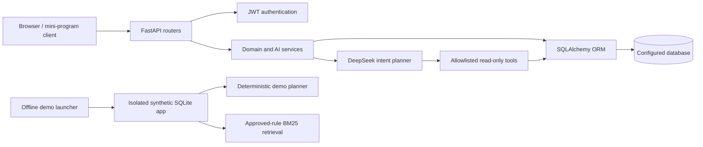

# Architecture

Production application entry: `app.main:app`. Routers delegate to services, which use SQLAlchemy sessions and ORM models. Configuration comes from environment variables via `app/core/config.py`. The offline demo is constructed separately by `app/offline_demo_app.py`; launcher isolates its environment and binds loopback. It does not accept a caller-provided database URL.

The service includes JWT login, student/admin routes, lesson records and migrations. The online natural-language path uses DeepSeek only for intent planning; database access remains in local allowlisted tools. Review deployment CORS and credentials before exposing the API publicly.
